# Joaninha — Gestão Escolar

Sistema de gestão para uma escola pública municipal de Educação Infantil e Ensino Fundamental I (do Maternal I ao 5º ano).

A ideia foi montar algo próximo do dia a dia de uma escola de verdade: secretaria cuidando das matrículas, professores lançando notas e fazendo chamada, coordenação acompanhando o desempenho das turmas e a direção com a visão geral.

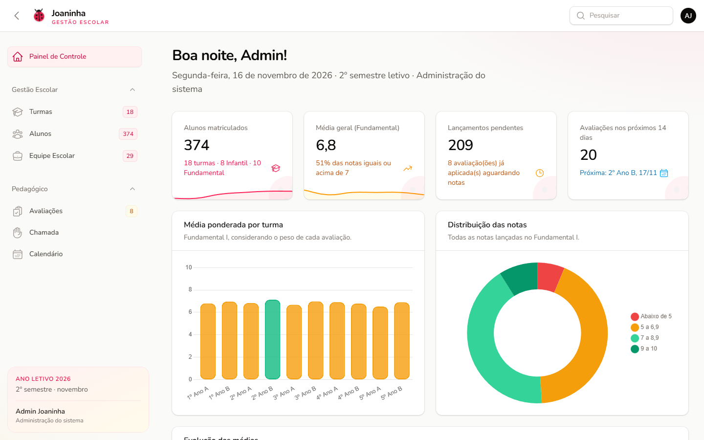

## O que o sistema faz

- **Turmas** — 18 turmas (Maternal I ao 5º ano, manhã e tarde), com professora regente, professores especialistas e auxiliares de classe.
- **Alunos** — cadastro com dados do responsável, informações de saúde (alergias e observações) e acompanhamento de Educação Especial / AEE.
- **Avaliações e diário de classe** — cada avaliação tem peso, e as notas são lançadas direto na tabela, aluno por aluno. A média da turma é ponderada pelos pesos.
- **Chamada** — registro diário de presença por turma, com cálculo da frequência de cada aluno.
- **Boletim** — boletim individual ou da turma inteira, pronto para impressão.
- **Calendário escolar** — feriados, reuniões de pais, conselhos de classe, eventos e datas de avaliação.
- **Equipe escolar** — direção, coordenação, secretaria, professores e auxiliares, cada um com o seu nível de acesso.
- **Painel de controle** — indicadores gerais, médias por turma, distribuição das notas, evolução ao longo dos bimestres e alunos com frequência baixa.

## Regras que seguimos

Algumas regras vieram da LDB (Lei 9.394/96) e de como as escolas públicas costumam funcionar:

- **Educação Infantil não tem nota.** A avaliação é feita por relatório descritivo (art. 31), então as turmas da Infantil não aparecem no diário de notas nem nas médias.
- **Frequência mínima de 75%** (art. 24). Alunos abaixo disso aparecem em destaque no painel.
- **Média 7,0** para aprovação, com notas de 0 a 10 e alerta para notas abaixo de 5.
- O ano letivo é dividido em **4 bimestres**.

## Perfis de acesso

| Perfil | O que pode fazer |
| --- | --- |
| Direção e Vice-direção | Acesso total, incluindo a gestão da equipe |
| Coordenação Pedagógica | Turmas, avaliações, diários e frequência de todas as turmas |
| Secretaria | Matrículas, turmas, calendário e frequência; consulta avaliações, mas não lança notas |
| Professor(a) | Só as próprias turmas: chamada, avaliações e diário de classe |
| Auxiliar de classe | Consulta os alunos das turmas em que atua e ajuda na chamada |

## Tecnologias

- PHP 8.4 e [Laravel 13](https://laravel.com)
- [Filament 5](https://filamentphp.com) e Livewire 4 para o painel
- MySQL 8
- Tailwind CSS 4 e Vite
- Laravel Sail (Docker) para o ambiente de desenvolvimento
- PHPUnit para os testes

## Como rodar

É preciso ter o **Docker** instalado (no Windows, com WSL2).

```bash
git clone https://github.com/Volktage/joaninha.git
cd joaninha
cp .env.example .env
```

Instalar as dependências do PHP (sem precisar ter PHP na máquina):

```bash
docker run --rm -u "$(id -u):$(id -g)" -v "$(pwd):/var/www/html" -w /var/www/html laravelsail/php84-composer:latest composer install --ignore-platform-reqs
```

Subir os containers e preparar o banco:

```bash
./vendor/bin/sail up -d
./vendor/bin/sail artisan key:generate
./vendor/bin/sail artisan migrate --seed
./vendor/bin/sail npm install
./vendor/bin/sail npm run build
```

Depois é só acessar **http://localhost/admin**.

O seeder cria uma escola completa com cerca de 370 alunos, 29 funcionários e seis meses de uso (avaliações, notas, chamadas e eventos). Os dados são sempre os mesmos a cada execução.

### Usuários para teste

| Usuário | Perfil | Senha |
| --- | --- | --- |
| admin@admin.com | Administrador | `P@ssw0rd` |
| sonia@escolajoaninha.com.br | Direção | `Joaninha@2026` |
| roberto.mendes@escolajoaninha.com.br | Vice-direção | `Joaninha@2026` |
| helena.martins@escolajoaninha.com.br | Coordenação | `Joaninha@2026` |
| marcia.santos@escolajoaninha.com.br | Secretaria | `Joaninha@2026` |
| claudia.rossini@escolajoaninha.com.br | Professora (Pré II B) | `Joaninha@2026` |

Vale entrar com perfis diferentes para ver como o menu e as permissões mudam.

## Testes

```bash
./vendor/bin/sail artisan test
```

Os testes cobrem os cálculos de média e frequência, as permissões de cada perfil, o cadastro das telas principais, a chamada, o boletim e o calendário.

## Telas

| | |
| --- | --- |
| 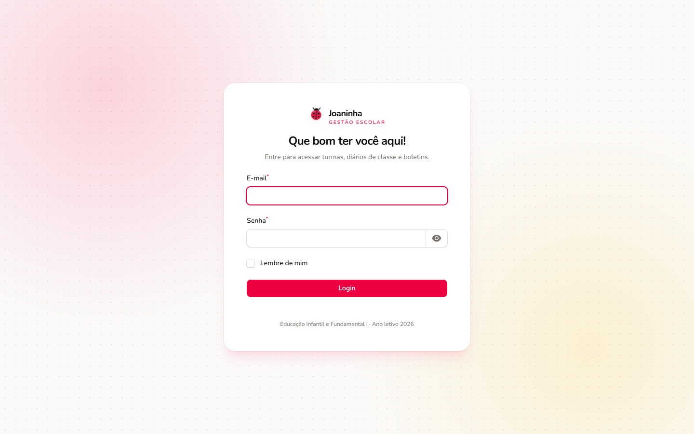 | 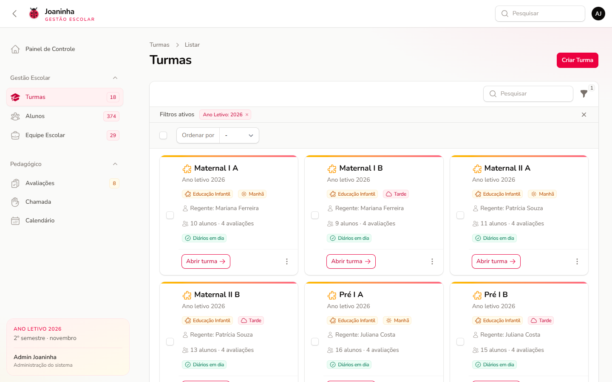 |
| Tela de login | Turmas |
| 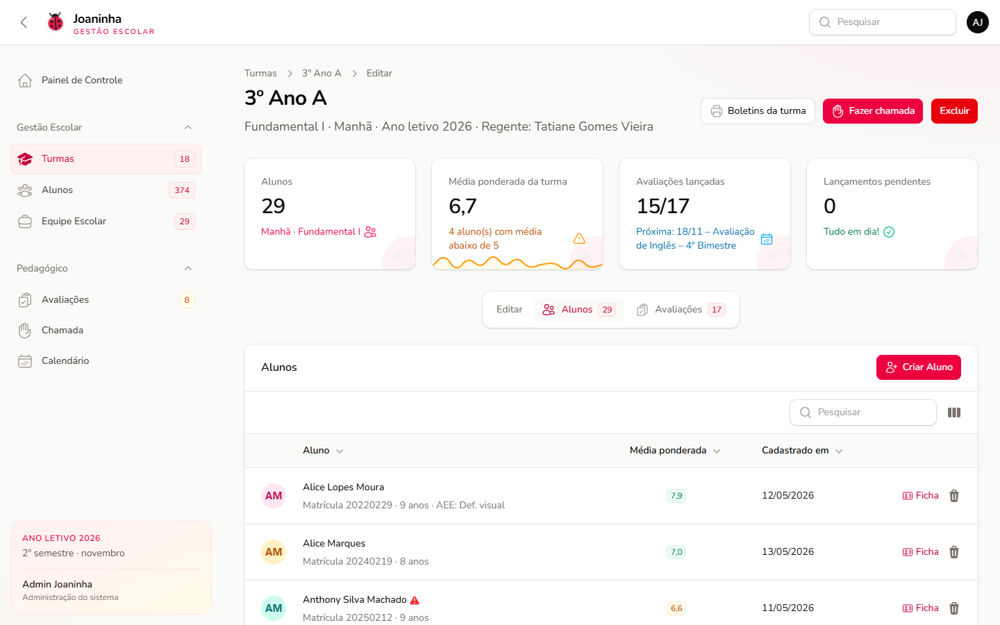 | 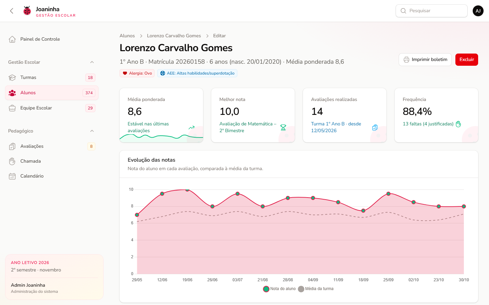 |
| Detalhes da turma | Ficha do aluno |
| 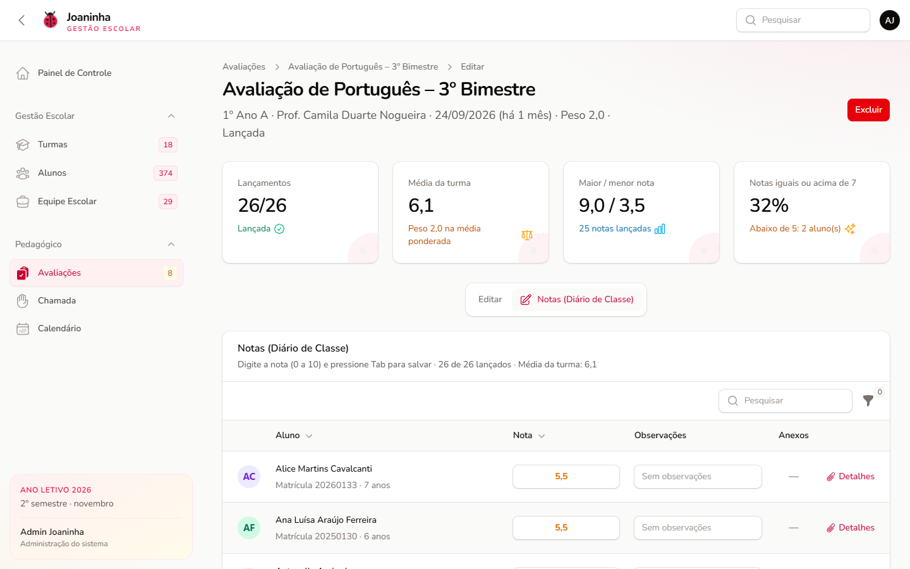 | 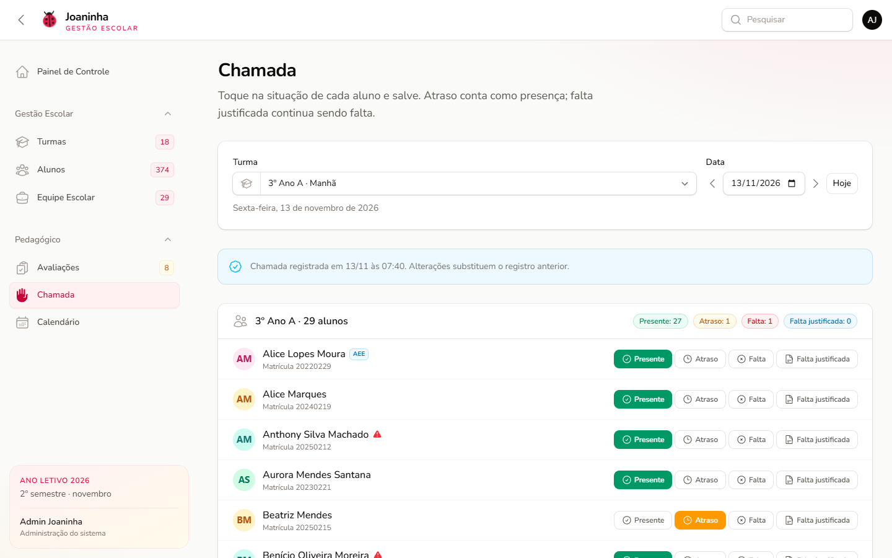 |
| Diário de classe | Chamada |
| 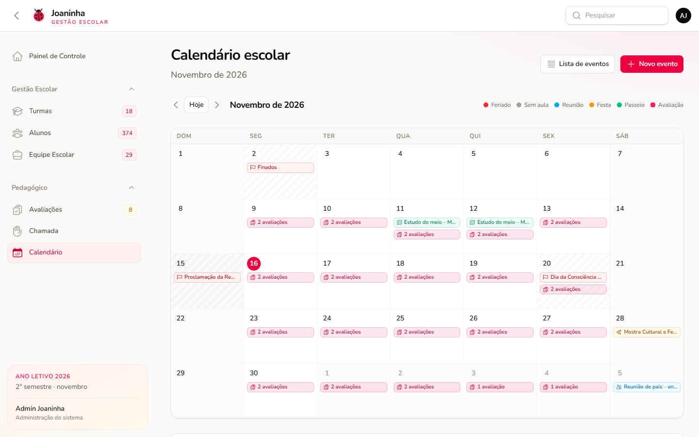 | 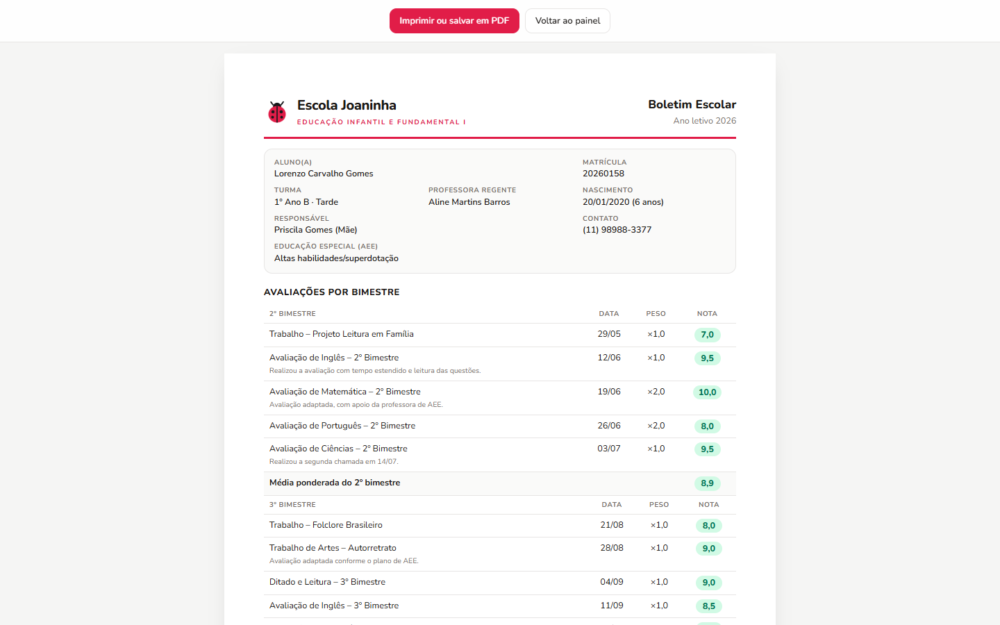 |
| Calendário escolar | Boletim para impressão |
| 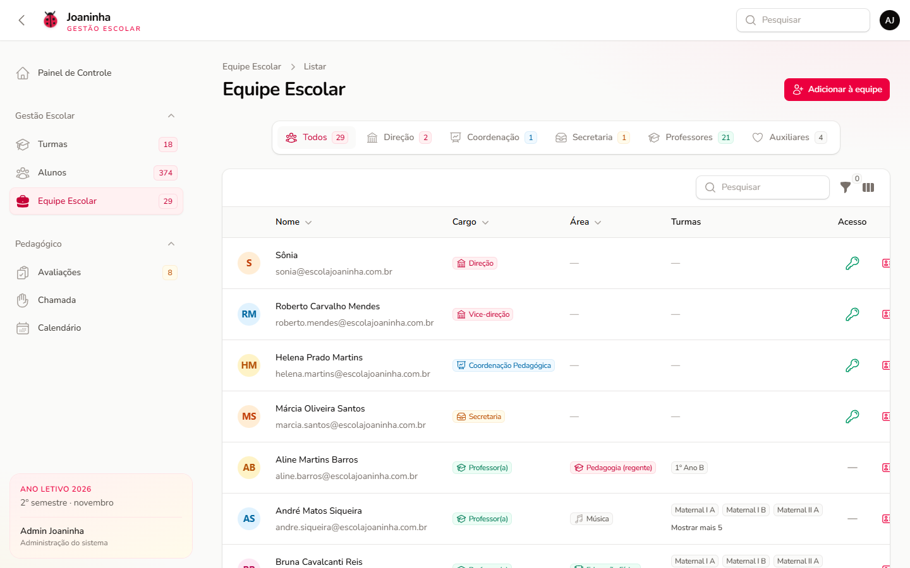 | 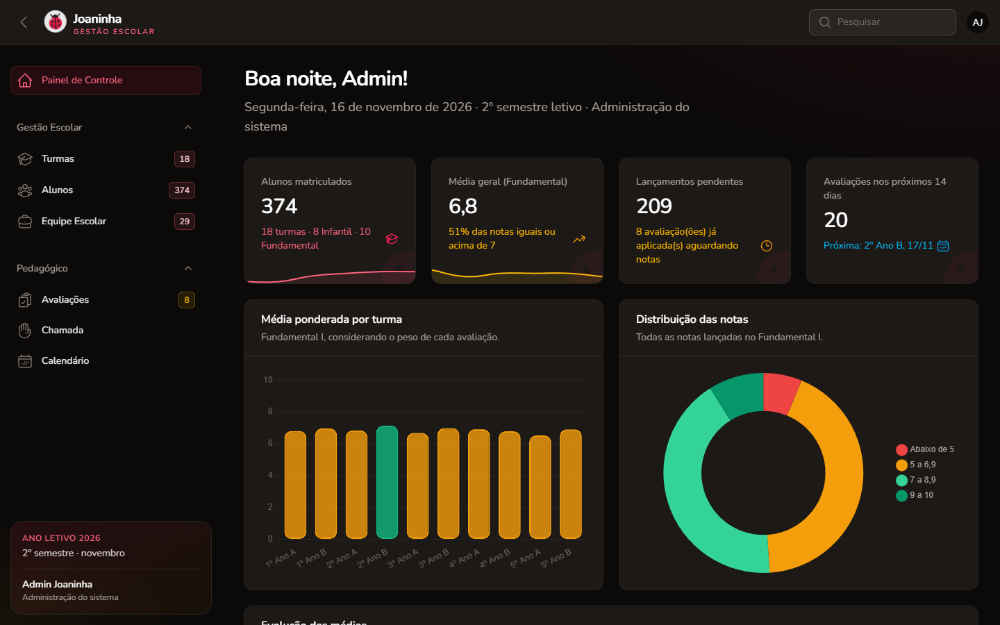 |
| Equipe escolar | Modo escuro |

## Estrutura

```
app/
├── Enums/            etapas, turnos, cargos, bimestres, tipos de evento...
├── Filament/
│   ├── Pages/        painel, chamada e calendário
│   ├── Resources/    turmas, alunos, avaliações, equipe e eventos
│   └── Widgets/      gráficos e indicadores do painel
├── Http/Controllers/ boletim para impressão
├── Models/
└── Policies/         regras de acesso de cada perfil
database/seeders/     dados de exemplo da escola
tests/Feature/        testes automatizados
```

## Autor

Leonardo Rossini Garcia — RU 3676446

Os nomes de alunos, funcionários e responsáveis usados no sistema são fictícios.
